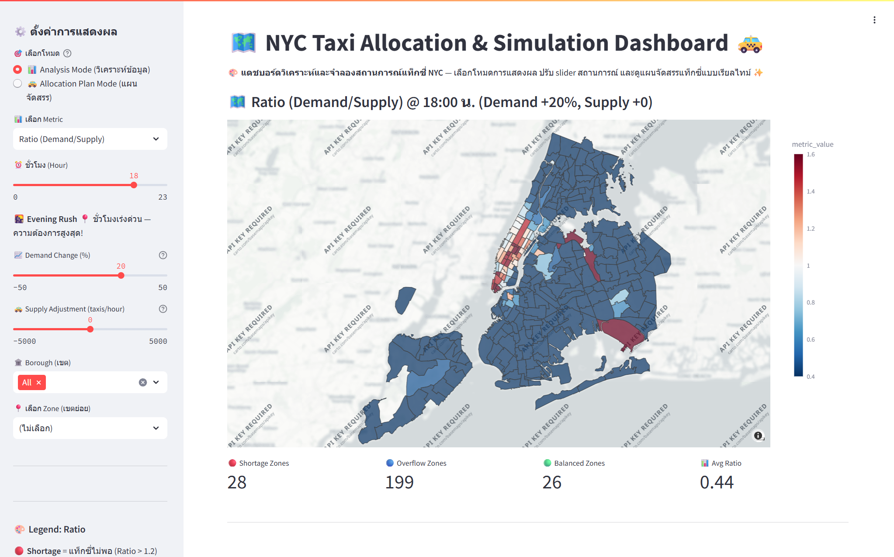
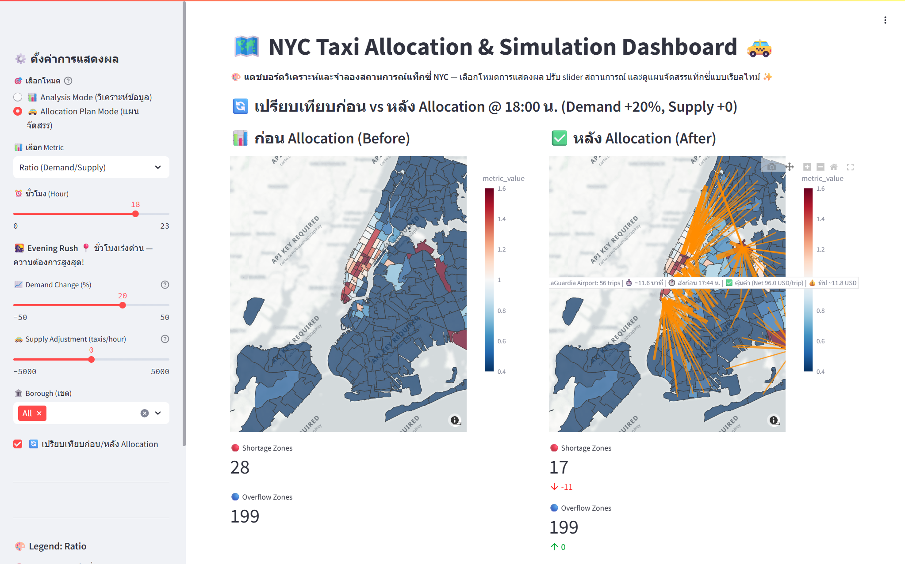
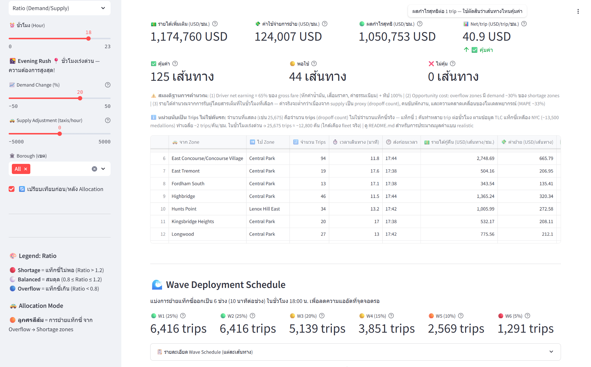
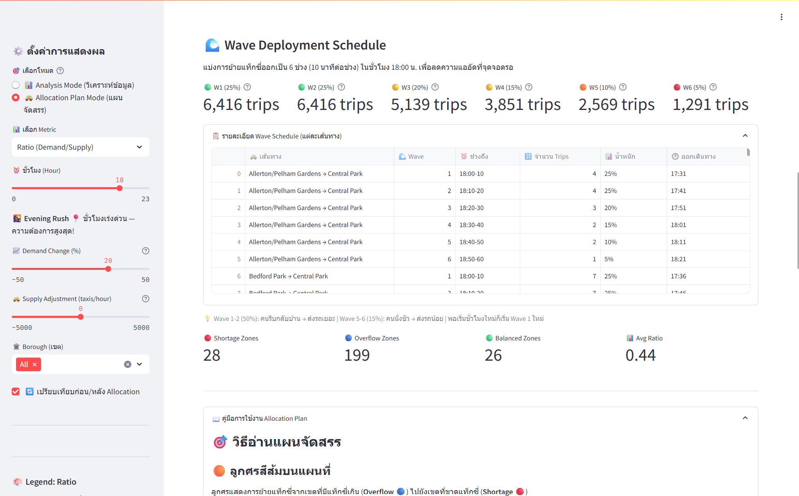

# NYC Taxi Demand-Supply Allocation System

## 📌 บทนำและที่มาของโปรเจกต์ (Background & Motivation)

ระบบการขนส่งแท็กซี่ในเมืองใหญ่อย่างนิวยอร์ก (NYC) เผชิญปัญหาความไม่สมดุลระหว่าง Demand และ Supply อย่างมากในแต่ละช่วงเวลาและพื้นที่ซึ่งสร้างผลกระทบเป็นวงกว้างทั้งในมิติคุณภาพชีวิตของคนขับ การพัฒนาเมืองของภาครัฐ และความพึงพอใจของผู้โดยสาร

### 🚕 1. มิติคุณภาพชีวิตและเศรษฐศาสตร์ของคนขับ (Driver's Well-being & Economics)
* **ภาระค่าใช้จ่ายคงที่และสุขภาพจิต:** คนขับแท็กซี่ส่วนใหญ่ต้องแบกรับค่าเช่ารถรายวัน ค่าบัตร ค่าตรวจสภาพรถ และค่าตรวจสุขภาพนวันที่ Demand ต่ำ การขับรถวนหาผู้โดยสารอย่างไม่มีเป้าหมายทำให้เกิดความเครียดสะสม และกระทบต่อสุขภาพจิตเนื่องจากรายได้ผันผวนเกินไป
* **การกระจายรายได้และโอกาสทางอาชีพ:** ระบบจัดสรร fleet เชิงรุกนี้ช่วยกู้คืนรายได้สุทธิเฉลี่ยเพิ่มขึ้นถึง **+$40.9 / ทริป-ชั่วโมง ในช่วงเวลา (Evening Rush)** ช่วยลดการขับรถวนโดยไร้จุดหมาย กระจายโอกาสในการสร้างรายได้ที่มั่นคงและคาดการณ์ได้มากขึ้น

### 🏛️ 2. มิติการพัฒนาเมืองและข้อมูลเชิงยุทธศาสตร์ภาครัฐ (TLC & Urban Planning)
* **การชี้เป้าพื้นที่เศรษฐกิจ:** ข้อมูลความต้องการเดินทางที่ชุกชุม (High-Demand Clusters) ช่วยให้หน่วยงานภาครัฐอย่างองค์กรแท็กซี่และลิมูซีนนิวยอร์ก (TLC) และนักผังเมือง มองเห็นย่านธุรกิจที่เติบโต เพื่อนำไปวางแผนจัดงานอีเวนต์ ตลาด หรือศูนย์กลางทางเศรษฐกิจได้อย่างคุ้มค่า
* **ดัชนีชี้วัดการพัฒนาพื้นที่:** ในทางกลับกัน เขตที่มี Demand ต่ำอย่างต่อเนื่อง จะเป็นสัญญาณเตือนเชิงข้อมูล (Data-driven indicator) ให้เทศบาลเมืองเข้าไปปรับปรุงโครงสร้างพื้นฐาน ถนนหนทาง และสภาพแวดล้อมเพื่อดึงดูดการเดินทาง

### 🏙️ 3. มิติผู้โดยสารและระบบการเดินทางของเมือง (Passenger Satisfaction & Mobility)
* **ลดระยะเวลาการรอคอย:** การกระจายรถแท็กซี่เข้าสู่พื้นที่ขาดแคลน (Shortage Zones) ในช่วงเวลาเร่งด่วน (เช่น Evening Rush) ช่วยลดเวลาคอยของผู้โดยสาร เพิ่มความพึงพอใจในการใช้บริการ และยกระดับประสิทธิภาพระบบขนส่งมวลชนภาพรวมของเมือง

## 📌 ภาพรวมโปรเจ็ค

ระบบวิเคราะห์และจัดสรรแท็กซี่ในนิวยอร์กซิตี้ เพื่อแก้ปัญหา demand-supply imbalance ในแต่ละเขต (borough) และโซน (zone) ระบบประกอบด้วย 3 ส่วน:

| ส่วนประกอบ | ไฟล์ | หน้าที่ |
|---|---|---|
| Notebook (Analysis) | `Drafts/NYC TLC CSV to Delta` | Data engineering, EDA, forecasting (SARIMA/Prophet), allocation analysis |
| Databricks App | `nyc-taxi-what-if-dashboard/app.py` | Interactive dashboard สำหรับจัดสรรแท็กซี่แบบ real-time |
| Lakeview Dashboard | `NYC Taxi Demand-Supply Dashboard.json` | 4 หน้า dashboard สำหรับผู้บริหาร |


---
## 📂 Project Structure & Files Overview

ตารางสรุปรายละเอียดไฟล์และโครงสร้างโฟลเดอร์ภายใน Repository นี้:

| File / Folder | Type | Description |
| :--- | :--- | :--- |
| **`GeoJSON / LocationID Mappings`** | GeoJSON File | ข้อมูลพิกัดเชิงพื้นที่ (Spatial Coordinates) และไฟล์ Lookup อ้างอิงจากแหล่งข้อมูลภายนอก |
| **`app.py`** | Python Source File | ซอร์สโค้ดหลักสำหรับรันและแสดงผล **Interactive Streamlit Web Application** |
| **`NYC Taxi Demand-Supply Dashboard.json`** | JSON File | ไฟล์ JSON บันทึกการกำหนดค่าและผลลัพธ์สถิติหลักส่วนใหญ่ที่สรุปออกมาจาก Jupyter Notebook |
| **`NYC Taxi Guide.pdf`** | Technical Reference | คู่มืออธิบายหลักการทำงานเชิงระบบและสถาปัตยกรรมข้อมูล (System & Architecture Manual) ไม่ใช่คู่มือการใช้งานสำหรับผู้ใช้ทั่วไป |
| **`NYC TLC Draft.ipynb`** | Jupyter Notebook | สมุดบันทึกกระบวนการทำงานแบบ End-to-End ตั้งแต่ Data Cleaning, Data Transformation, การวิเคราะห์สถิติเพื่อหาความน่าเชื่อถือ จนถึงการเทรนและประเมินโมเดล **SARIMA** |
| **`README.md`** | Markdown File | เอกสารอธิบายภาพรวมโปรเจกต์ สถาปัตยกรรมระบบ และรายละเอียดโครงสร้างไฟล์ |
## 📊 ข้อมูลที่ใช้

- **แหล่ง**: NYC Taxi & Limousine Commission (TLC) Yellow Taxi Trip Data (Kaggle)
- **ช่วงเวลา**: มกราคม 2015–2018 (4 ปี, 42M trips รวม)
- **ปีที่ใช้วิเคราะห์ผลหลัก**: มกราคม 2018 (31 วัน, 8.7M trips)
- **ระดับ**: รายชั่วโมง แยกตาม zone (263 zones)
- **พิกัด**: lat/lon จาก NYC Taxi Zones GeoJSON

### ทำไมใช้ 4 ปี แต่วิเคราะห์ 2018 อย่างเดียว?

ข้อมูล 4 ปี (2015–2018) ถูกใช้ทั้งหมด แต่ในบทบาทต่างกัน:

| การวิเคราะห์ | ใช้ข้อมูลปีไหน | เหตุผล |
|---|---|---|
| Trend ข้ามปี (Cell 28–32) | 2015–2018 ทั้งหมด | ดูแนวโน้ม demand ลดลง −31% ใน 4 ปี |
| Time Series Forecasting (Cell 74–80) | 2015–2018 รายวัน | พยากรณ์ต้องการข้อมูลหลายปีเพื่อจับ trend |
| Demand-Supply Ratio (Cell 45) | 2018 เท่านั้น | ต้องการสถานการณ์ล่าสุด |
| Zone-level Analysis (Cell 61) | 2018 เท่านั้น | **2015–2016 ไม่มี LocationID** (มีแค่ GPS coords) |
| Allocation Plan + App | 2018 เท่านั้น | ใช้ zone-level → ต้องมี LocationID |

**เหตุผลหลัก**: การวิเคราะห์ allocation plan ต้องการระดับ zone (263 zones) เพื่อบอกว่า JFK Airport ขาดรถ ไม่ใช่แค่ Queens ขาดรถ — ข้อมูล 2015–2016 มีแค่ GPS coordinates จึงวิเคราะห์ระดับ zone ไม่ได้ และ 2018 เป็นปีล่าสุดที่สะท้อนสถานการณ์ปัจจุบันมากที่สุด

**ข้อจำกัด**: มีเฉพาะเดือนมกราคม → ไม่เห็น seasonal pattern รายปี (holiday season, summer tourism) เป็น known limitation ที่ระบุไว้ในรายงาน

### คอลัมน์ที่ใช้และบทบาท

| คอลัมน์ | บทบาท | ใช้ในส่วนไหน |
|---|---|---|
| `tpep_pickup_datetime` | คำนวณ demand (pickup count) + time series | Demand, Forecasting |
| `tpep_dropoff_datetime` | คำนวณ supply (dropoff count) + trip_duration | Supply, Cost validation |
| `PULocationID` | ระบุพิกัด/เขตของ pickup → join taxi_zones | Demand |
| `DOLocationID` | ระบุพิกัด/เขตของ dropoff → join taxi_zones | Supply |
| `trip_distance` | validate ระยะทางจริง vs Euclidean | Cost validation |
| `tip_amount` | สร้าง tip map เป็น incentive สำหรับคนขับ | Incentive |
| `RatecodeID` | แยก airport (2=JFK, 3=EWR) vs local trips | Classification |
| `fare_amount` | คำนวณ revenue per trip | Cost-benefit |
| `total_amount` | บอก stakeholder ว่าการแก้ imbalance คุ้มเงินเท่าไหร่ | Revenue context |

---

## 🧹 ขั้นตอนเตรียมข้อมูล (Data Preparation)

### Pipeline ภาพรวม

```
Kaggle CSV (4 ไฟล์, ~1.2GB)
  ↓  Cell 8: แปลง CSV → Delta บน UC Volume
Delta (42M rows)
  ↓  Cell 10: Union 4 ปี (allowMissingColumns)
df_all (22 cols, 42M rows)
  ↓  Cell 12: ตรวจสอบ missing + ทำความสะอาด
df_clean (41.8M rows, ลบ 0.66%)
  ↓  Cell 14: แปลง datetime + คำนวณ trip_duration
  ↓  Cell 17: สร้าง time features (hour, dayofweek, is_weekend)
  ↓  Cell 19: สร้าง spatial features (LocationID join + spatial join → borough)
  ↓  Cell 21: คำนวณ demand-supply metrics (borough × hour)
  ↓  Cell 23: กรองข้อมูลผิดปกติ + fill missing
df_clean (พร้อมวิเคราะห์)
  ↓  Cell 61: Zone-level aggregation (2018, 263 zones)
zone_hourly_enhanced.parquet (พร้อมให้ App ใช้)
```

### รายละเอียดแต่ละขั้นตอน

#### 1. ดาวน์โหลดและแปลงเป็น Delta (Cells 1–8)

- ดาวน์โหลด NYC TLC dataset จาก Kaggle ด้วย `kagglehub` (4 ไฟล์ CSV, ~1.2GB)
- แปลงแต่ละไฟล์ CSV เป็น Delta format บน UC Volume เพื่ออ่านเร็วและรองรับ schema evolution
- เพิ่มคอลัมน์ `year` เพื่อระบุปีของข้อมูล

| ปี | Rows | คอลัมน์ | มี LocationID? |
|---|---|---|---|
| 2015 | 12,748,981 | 20 (มี GPS: lat/lon) | ❌ |
| 2016 | 10,904,434 | 20 (มี GPS: lat/lon) | ❌ |
| 2017 | 9,706,675 | 18 (มี LocationID) | ✅ |
| 2018 | 8,765,752 | 18 (มี LocationID) | ✅ |
| **รวม** | **42,125,842** | | |

#### 2. รวม 4 ปีเป็น DataFrame เดียว (Cell 10)

- ใช้ `unionByName(allowMissingColumns=True)` รวม 4 ปี
- **ปัญหา schema ต่างกัน**: 2015–2016 มี GPS columns, 2017–2018 มี LocationID
- ผลลัพธ์: 22 คอลัมน์ (คอลัมน์ที่ไม่มีในบางปี → null)

#### 3. ตรวจสอบ Missing Values + ทำความสะอาด (Cell 12)

| คอลัมน์ | Missing | สาเหตุ |
|---|---|---|
| datetime, trip_distance, fare_amount | 0 | — |
| GPS coords (4 คอลัมน์) | 43.84% | 2017–2018 ใช้ LocationID แทน |
| PULocationID / DOLocationID | 56.16% | 2015–2016 ใช้ GPS แทน |

**กลยุทธ์ cleaning:**
1. `dropna` เฉพาะ required cols (datetime, distance, fare) — ไม่มี missing อยู่แล้ว
2. เก็บแถวที่มี **GPS ครบ หรือ LocationID ครบ** (either-or) — ไม่ลบข้ามปี
3. กรอง `trip_distance > 0` และ `fare_amount > 0` — ลบ 277,518 rows (0.66%)

> 💡 **Key decision**: ไม่ลบ GPS null (43.84%) เพราะเป็น 2017–2018 ที่ใช้ LocationID แทน — ถ้าลบจะทิ้งข้อมูล 2 ปีล่าสุด

#### 4. แปลง Datetime + สร้าง Time Features (Cells 14, 17)

- แปลง `tpep_pickup_datetime` / `tpep_dropoff_datetime` เป็น timestamp
- คำนวณ `trip_duration_minutes` = (dropoff − pickup) ในหน่วยนาที
- สร้าง time features:
  - `pickup_hour` (0–23): จัดกลุ่มตามชั่วโมง, หา rush hour
  - `pickup_dayofweek` (1=อาทิตย์…7=เสาร์): แยก weekday/weekend
  - `is_weekend` (0/1): เปรียบเทียบ pattern

#### 5. สร้าง Spatial Features (Cell 19)

**ปัญหา**: 2015–2016 มี GPS, 2017–2018 มี LocationID → ต้องทำให้ align กัน

| ปี | วิธี map → borough | เทคนิค |
|---|---|---|
| 2017–2018 | `broadcast join` บน LocationID | เร็ว (zone lookup 263 rows) |
| 2015–2016 | `spatial join` ด้วย `st_contains` | ใช้ lat/lon + polygon geometry |

- ใช้ `st_geomfromwkt` แปลง WKT geometry จาก zones CSV
- ใช้ `st_contains(geom, st_point(lon, lat))` หาว่าพิกัดอยู่ใน borough ไหน
- `broadcast()` เพื่อป้องกัน shuffle 23M rows
- ผลลัพธ์: ทุกปีมี `pickup_borough` และ `dropoff_borough` (NULL ~1-2% = นอก polygon)

#### 6. คำนวณ Demand-Supply Metrics (Cell 21)

- **Demand** = `groupBy(pickup_borough, pickup_hour).agg(count("*"))`
- **Supply** = `groupBy(dropoff_borough, dropoff_hour).agg(count("*"))`
- Join ด้วย `outer join` บน (borough, hour)
- คำนวณ `demand_supply_ratio = demand / supply`
- จำแนก `imbalance`: ratio > 1.2 = ขาด, < 0.8 = ล้น, อื่นๆ = สมดุล

> ⚠️ Supply = dropoff count เป็น **proxy** ไม่ใช่จำนวนรถว่างจริง — 1 trip สร้าง 1 demand (ที่ pickup zone × pickup hour) และ 1 supply (ที่ dropoff zone × dropoff hour) ซึ่งนับที่คนละที่และอาจต่างชั่วโมงกัน

#### 7. กรองข้อมูลผิดปกติเพิ่ม (Cell 23)

- `trip_distance > 0` และ `≤ 100` ไมล์ (ลบ trip 0 ไมล์หรือเกินจริง)
- `fare_amount ≥ 0` (ลบค่าโดยสารติดลบ)
- Fill missing borough ด้วย "Unknown"

---

## 🧮 สูตรและค่าคงที่ทั้งหมด

### 1. Demand-Supply Ratio

```
ratio = demand / supply
```

- `demand` = จำนวน pickup ใน zone นั้น ในชั่วโมงนั้น
- `supply` = จำนวน dropoff ใน zone นั้น ในชั่วโมงนั้น (proxy — ไม่ใช่จำนวนรถว่างจริง)

### 2. Threshold สมดุล (0.8–1.2)

```
status = 'Shortage'  if ratio > 1.2
status = 'Overflow'   if ratio < 0.8
status = 'Balanced'   if 0.8 <= ratio <= 1.2
```

**ทำไม 0.8 และ 1.2**: 1.0 คือ demand = supply พอดี ให้ buffer ±20% เพื่อยอมรับว่า demand และ supply ไม่ต้องเท่ากันเป๊ะ ถ้าใช้ 1.0 ทุกเขตที่ ratio 1.01 จะถูกมองว่าขาดทั้งหมด ไม่สมเหตุสมผล

### 3. Excess และ Shortfall Calculation

```
excess    = (supply_adjusted × 0.8) - demand_adjusted   (clip 0)
shortfall = demand_adjusted - (supply_adjusted × 1.2)   (clip 0)
```

**ทำไม 0.8 และ 1.2 (buffer 20%)**:

1. **ป้องกันเขตต้นทางขาดรถเอง** — เก็บไว้อย่างน้อย 80% ของ supply ไม่ดึงออกหมด
2. **ตัดรถที่พักงาน** — สมมติว่า ~20% ของ dropoff เป็นรถที่จอดพัก ไม่รับงาน
3. **รถที่เดินทางออกจากโซน** — รถที่ dropoff แล้วขับออกทันที ไม่รับผู้โดยสารใหม่
4. **Demand spike ภายในชั่วโมง** — demand ไม่ได้นิ่ง มี spike ในบางนาที
5. **ความคลาดเคลื่อนของ proxy** — supply = dropoff count ไม่ใช่รถว่างจริง มี noise
6. **สมดุลกับ shortfall threshold** — overflow เก็บ 80% supply, shortage ต้องการ supply เพิ่ม 20% จาก demand สอดคล้องกัน

### 4. Borough Adjacency Matrix

```python
borough_adjacency = {
    "Manhattan":      {"Manhattan", "Bronx", "Brooklyn", "Queens"},
    "Brooklyn":       {"Brooklyn", "Manhattan", "Queens"},
    "Queens":         {"Queens", "Manhattan", "Brooklyn"},
    "Bronx":          {"Bronx", "Manhattan"},
    "Staten Island":  {"Staten Island"},   # ไม่ย้ายออก (ไม่มีสะพานเชื่อมโดยตรง)
    "EWR":            {"EWR"},             # ไม่ย้ายออก (New Jersey ข้ามแม่น้ำ Hudson)
}
```

**ทำไมต้องมี**: ป้องกันการแนะนำให้ย้ายแท็กซี่ข้ามแม่น้ำ Hudson หรือข้ามน้ำอื่นๆ ที่ไม่มีสะพานเชื่อม ทำให้แผนจัดสรรเป็นแผนที่ execute ได้จริง

### 5. Max Distance: 0.15 degrees (≈16.6 km)

```
max_distance = 0.15  # degrees (Euclidean)
0.15° × 111 km/° = 16.6 km (straight line)
16.6 km × 1.3 (road factor) ≈ 21.6 km (road distance)
```

**ทำไม 0.15 degrees**:
- ครอบคลุมเขตที่ติดกัน: Manhattan↔Brooklyn (12 km), Manhattan↔Bronx (13.7 km), Queens↔Bronx (15.1 km)
- บล็อกเขตที่ไกลเกินไป: Manhattan↔Staten Island (30+ km), Brooklyn↔Bronx (20.5 km)
- ใช้กับระดับ zone — โซนที่อยู่ขอบ Queens ติด Manhattan (เช่น Long Island City) จะอยู่ในระยะของโซน Manhattan ได้
- 1.3x = road factor สำหรับถนน NYC ที่ไม่ได้ตรงเป็นเส้นตรง

### 6. Travel Time Estimation: 40 km/h

```
dist_km = dist_degrees × 111
est_travel_min = (dist_km / 40) × 60
```

**ทำไม 40 km/h**: ความเร็วเฉลี่ย NYC ที่ครอบคลุมทั้งถนนและทางด่วน

| พื้นที่ | ความเร็วจริง |
|---|---|
| Manhattan rush hour | 18 km/h |
| Manhattan off-peak | 25 km/h |
| Outer boroughs | 35 km/h |
| ทางด่วน | 65 km/h |
| **เฉลี่ยทั้งเมือง** | **40 km/h** ← ใช้ค่านี้ |
| Rush hour average | 28 km/h |

- ถ้าใช้ 28 km/h (rush hour): ระยะ 30 นาทีจะลดเหลือ 14 km กรองเขตได้น้อยเกินไป
- ถ้าใช้ 50 km/h: ระยะ 30 นาทีจะเพิ่มเป็น 25 km แนะนำให้ย้ายไกลเกินจริง
- 40 km/h เป็นจุดสมดุลที่ไม่กรองมากเกินไปหรือแนะนำผิด

### 7. Travel Time Cap: 30 นาที

```
if est_travel_min > 30:
    continue  # skip this route
```

**ทำไม 30 นาที**:
- Rush hour ยาว 2-3 ชั่วโมง (เช่น 17:00-19:00) — ถ้าย้ายรถใช้ 30+ นาที เสียครึ่งช่วงวิกฤตไปแล้ว
- 30 นาที @ 40 km/h = 20 km ทางจริง — ครอบคลุมระยะในเมืองส่วนใหญ่
- Opportunity cost: รถที่ใช้เวลาย้าย 30+ นาที เสียรายได้จาก trip ที่ตัดไประหว่างทาง

### 8. Recommended Departure Time

```
total_min_before = int(est_travel_min) + 5  # 5 min buffer
depart_total_min = target_hour × 60 - total_min_before
# → "ส่งรถก่อน 17:23 น. เพื่อถึงก่อน 18:00"
```

**ทำไม buffer 5 นาที**: ป้องกันความล่าช้าจากการประสานงาน การเรียกรถ หรือการจราจรที่คาดเดาไม่ได้ ทำให้แท็กซี่ไปถึงก่อนช่วง rush hour จริงๆ เริ่ม

### 9. Minimum Allocation: > 10 คัน

```
if amount > 10:
    # proceed with allocation
```

**ทำไม 10**: ไม่แนะนำให้ย้ายแท็กซี่จำนวนน้อยเกินไป เพราะไม่คุ้มกับความยุ่งยากในการประสานงาน การสื่อสาร และ management overhead

### 10. Cost-Benefit Analysis

#### Revenue Recovered ($/เส้นทาง/ชม.)

```
avail_min = max(0, 60 - est_travel_min)
trips_per_taxi = max(1, avail_min / 15)         # 15 min per trip cycle
gross_fare = 52.0 if is_airport else 13.0       # JFK flat $52, standard $13
driver_earning_ratio = 0.65                      # Driver keeps 65% after expenses
avg_fare = gross_fare × driver_earning_ratio     # Driver net earning
revenue_per_trip = avg_fare + dest_tip

# Revenue at shortage zone (high demand)
revenue_at_shortage = trips_per_taxi × revenue_per_trip

# Opportunity cost: revenue lost if staying at overflow zone
trips_at_overflow = trips_per_taxi × 0.3        # Overflow zones have ~30% of shortage demand
revenue_at_overflow = trips_at_overflow × revenue_per_trip

# Net revenue gain from relocation
revenue_recovered = amount × (revenue_at_shortage - revenue_at_overflow)
```

- **15 min per trip cycle**: เวลาเฉลี่ยต่อ trip ใน NYC (pickup + dropoff + wait time)
- **$13 standard / $52 JFK flat fare**: ค่าโดยสารเต็ม (gross fare) จากข้อมูล TLC
- **65% driver earning ratio**: คนขับได้เฉพาะ 65% หลังหักค่าน้ำมัน (~20%), เสื่อมราคา (~10-15%), ค่าธรรมเนียม (~5%)
  - Standard trip: $13 × 0.65 = **$8.45** (driver net)
  - JFK trip: $52 × 0.65 = **$33.80** (driver net)
- **Opportunity cost**: แท็กซี่ที่อยู่ overflow zone ก็ยังหารายได้ได้ (แม้จะน้อย) → ต้องหัก revenue ที่เสียไปออก
  - Overflow zones มี demand ประมาณ 30% ของ shortage zones (conservative estimate)
  - ถ้าไม่หัก → revenue พองเกินจริง 20-30%
- **หน่วย**: ดอลลาร์ต่อเส้นทางต่อชั่วโมง (รายได้สุทธิที่เพิ่มขึ้นจริงๆ จากการย้าย)

#### Allocation Cost ($/เส้นทาง)

```
lost_earning = (est_travel_min / 60) × 30.0   # $30/hour avg taxi earning
fuel_cost = dist_km × 0.15                     # $0.15/km
allocation_cost = amount × (lost_earning + fuel_cost)
```

- **$30/hour**: รายได้เฉลี่ยต่อชั่วโมงของแท็กซี่ NYC (ค่าเสียโอกาสระหว่างขับว่างไปโซนใหม่)
- **$0.15/km**: ค่าน้ำมันโดยประมาณ (fuel cost per km)
- **หน่วย**: ดอลลาร์ต่อเส้นทาง (ค่าใช้จ่ายครั้งเดียวสำหรับย้ายแท็กซี่ทั้งหมดในเส้นทางนี้)

#### Net Benefit

```
net_benefit = revenue_recovered - allocation_cost
net_benefit_per_trip = net_benefit / amount
```

- **Net/trip หน่วย**: ดอลลาร์ต่อ trip ต่อชั่วโมง (กำไรสุทธิต่อ 1 trip ที่ย้าย)
- **ทำไมดูต่อ trip**: เส้นทางที่ย้าย 150 trips อาจมี Net สูงแค่เพราะ trips เยอะ แต่ถ้าดูต่อ trip จะเห็นว่าเส้นทางไหนคุ้มจริง ทำให้ label ไม่ขึ้นกับจำนวน trips
- ⚠️ จำนวนที่แสดงเป็น **trips** (dropoff count) ไม่ใช่จำนวนแท็กซี่จริง — แท็กซี่ 1 คันทำ ~2 trips/ชม. ตามข้อมูล TLC

#### Threshold ความคุ้มค่า (per trip)

```
✅ คุ้มค่า:   net_benefit_per_trip > $20/trip   (รถหาเงินได้ 2-3 เท่าของค่าย้าย)
🟡 พอใช้:   $0 < net_benefit_per_trip <= $20/trip (กำไรน้อย อาจไม่คุ้ม management overhead)
❌ ไม่คุ้ม:   net_benefit_per_trip <= $0/trip      (เสียเงิน ควรหาทางอื่น)
```

**ทำไม $20/trip**:
- รายได้สุทธิต่อ trip ต่อชั่วโมง (หลังหัก opportunity cost):
  - Standard trips: ~$18-27/ชม. (3 trips × $8.45 × 70% net gain)
  - Airport trips: ~$68-101/ชม. (2 trips × $33.80 × 70% net gain)
- ค่าย้ายต่อ trip: ~$5-15 (เวลา + น้ำมัน)
- $20 net/trip = รถหาเงินได้เพิ่มขึ้นมากกว่าค่าย้าย 1-4 เท่า → คุ้มค่าที่จะย้าย
- ต่ำกว่า $20 = กำไรน้อยเกินไป อาจไม่คุ้มกับ management overhead

### 11. Summary Cards และ Summary Row

ใน Databricks App มี **4 summary cards** แสดงข้อมูลรวมของทั้งหมด:

#### 4 Summary Cards (บรรทัด 552-558 ใน app.py)

```
cb1: 💵 รายได้เพิ่มเติม (USD/ชม.)           = total_rev
cb2: 💸 ค่าใช้จ่ายการย้าย (USD/ชม.)        = total_cost
cb3: 🟢 ผลกำไรสุทธิ (USD/ชม.)              = total_net = total_rev - total_cost
cb4: 📊 Net/trip (USD/trip/ชม.)           = avg_net_per_trip = total_net / total_moved
```

**ความหมาย:**
- **cb1 (รายได้เพิ่มเติม)**: รายได้เพิ่มเติมจากการย้ายแท็กซี่ไป shortage zones (ก่อนหักค่าย้าย) — คำนวณจาก driver net earning (65% ของ gross fare) + tip - opportunity cost (overflow zones มี demand 30%)
- **cb2 (ค่าใช้จ่ายการย้าย)**: ค่าใช้จ่ายในการย้ายแท็กซี่ = เวลาเสียระหว่างขับว่าง ($30/ชม.) + น้ำมัน ($0.15/km)
- **cb3 (ผลกำไรสุทธิ)**: ผลกำไรสุทธิจากระบบจัดสรร (= รายได้เพิ่มเติม - ค่าใช้จ่าย) — **ตัวเลขนี้ที่กู้คืนได้จริง!** 🎯
- **cb4 (Net/trip)**: กำไรสุทธิต่อ 1 trip (มี label คุ้มค่า/พอใช้/ไม่คุ้ม) — ใช้ตัดสินว่าเส้นทางไหนคุ้มค่า

**สมการตรวจสอบ:**
```
ผลกำไรสุทธิ = รายได้เพิ่มเติม - ค่าใช้จ่าย
total_net = total_rev - total_cost ✅

ตัวอย่าง (จากภาพ summary cards):
cb3 (1,050,753 USD) = cb1 (1,174,760 USD) - cb2 (124,007 USD) ✅
```

#### Summary Row (บรรทัด 560-568 ใน app.py)

แสดงจำนวนเส้นทางแต่ละระดับ:

```
✅ คุ้มค่า:  count_good = sum(1 for a in allocations if a.get('net_benefit_per_trip', 0) > 20)
🟡 พอใช้:  count_ok   = sum(1 for a in allocations if 0 < a.get('net_benefit_per_trip', 0) <= 20)
❌ ไม่คุ้ม:  count_bad  = sum(1 for a in allocations if a.get('net_benefit_per_trip', 0) <= 0)
```

**ความหมาย:**
- ผู้บริหารมองเห็นว่าแผนจัดสรรมีเส้นทางคุ้มค่ากี่เส้นทาง (Net/trip > $20)
- ใช้ตัดสินใจว่าระบบนี้มีผลดีขนาดไหน — ถ้าส่วนใหญ่เป็น "คุ้มค่า" = ควรทำ

---

## 🏗️ Allocation Algorithm

```
1. คัดแยก overflow zones (ratio < 0.8) และ shortage zones (ratio > 1.2)
2. คำนวณ excess และ shortfall (พร้อม buffer 20%)
3. สร้าง distance matrix ระหว่าง overflow และ shortage zones (numpy vectorized)
4. สำหรับแต่ละ overflow zone:
   a. กรองเฉพาะ shortage zones ที่อยู่ใน borough ที่ติดกัน (adjacency)
   b. เรียง shortage zones ตามระยะทาง (ใกล้สุดก่อน)
   c. กรองเฉพาะเส้นทาง ≤ 0.15° (≈16.6 km)
   d. กรองเฉพาะเส้นทาง ≤ 30 นาที travel time
   e. กรองเฉพาะ amount > 10 คัน
   f. คำนวณ cost-benefit และ recommended departure time
   g. ย้ายรถไกลสุดเท่าที่ excess และ shortfall ยอม
5. อัพเดท supply หลัง allocation และคำนวณ ratio/status ใหม่
```

### ลำดับ Constraint (4 ชั้น)

| ชั้น | Constraint | บรรทัดใน app.py |
|---|---|---|
| 1 | Borough adjacency (ไม่ข้ามน้ำ) | 101-108 |
| 2 | Distance ≤ 0.15° (≤16.6 km) | 109, 132 |
| 3 | Travel time ≤ 30 นาที | 139 |
| 4 | Minimum amount > 10 คัน | 142 |

---

## 🌊 Wave Deployment System

### หลักการ

แทนที่จะส่งแท็กซี่ทั้งหมดพร้อมกันในช่วงเริ่มชั่วโมง ระบบแบ่งการย้ายรถออกเป็น **6 ช่วง × 10 นาที** ต่อชั่วโมง เพื่อลดความแออัดที่จุดจอดรอ (staging area) และการจราจร

### น้ำหนักแต่ละ Wave

```python
WAVE_WEIGHTS = [0.25, 0.25, 0.20, 0.15, 0.10, 0.05]
```

| Wave | ช่วงเวลา (นาทีในชั่วโมง) | น้ำหนัก | เหตุผล |
|---|---|---|---|
| 1 | 0-10 | 25% | คนรีบกลับบ้าน → ต้องการรถเร็วสุด |
| 2 | 10-20 | 25% | ยังคง demand สูง |
| 3 | 20-30 | 20% | demand ปานกลาง |
| 4 | 30-40 | 15% | demand ลดลง |
| 5 | 40-50 | 10% | คนนั่งชิว ไม่รีบ |
| 6 | 50-60 | 5% | คนที่เหลือ |

### สูตรคำนวณเวลาออกเดินทางของแต่ละ Wave

```
arrival_start = wave_index × 10  (นาทีในชั่วโมงเป้าหมาย)
departure = target_hour × 60 + arrival_start - travel_time - 5 (buffer)
```

- `travel_time` = ระยะทาง ÷ 40 km/h × 60 (นาที)
- `5` = buffer นาที ป้องกันความล่าช้า
- พอเริ่มชั่วโมงใหม่ → เริ่ม Wave 1 ใหม่ วนซ้ำ

### ทำไมต้องถ่วงน้ำหนัก 25/25/20/15/10/5

1. **คนตรงเวลามากในตอนต้นชั่วโมง** — ช่วงเลิกงานคนรีบกลับ → ต้องการรถเร็ว → Wave 1-2 ต้องมีรถเยอะ
2. **ถ้าแบ่งเท่ากัน (16.67% ต่อ Wave)** — รถจะหมดตั้งแต่ Wave 3-4 คนที่มาสายต้องรอชั่วโมงถัดไป
3. **คนที่มาสายไม่รีบ** — Wave 5-6 เป็นคนที่ไม่รีบ ส่งรถน้อยลงได้
4. **ลด congestion** — ส่งรถกระจาย ไม่รวมก้อนที่จุดจอด

### ตัวอย่าง

เส้นทาง: Midtown Center → Penn Station, 150 คัน, travel time 15 นาที, target hour 18:00

| Wave | ถึงช่วง | จำนวนแท็กซี่ | ออกเดินทางก่อน |
|---|---|---|---|
| 1 | 18:00-10 | 38 คัน (25%) | 17:40 |
| 2 | 18:10-20 | 38 คัน (25%) | 17:50 |
| 3 | 18:20-30 | 30 คัน (20%) | 18:00 |
| 4 | 18:30-40 | 22 คัน (15%) | 18:10 |
| 5 | 18:40-50 | 15 คัน (10%) | 18:20 |
| 6 | 18:50-60 | 7 คัน (5%) | 18:30 |

### Edge Case

ถ้าจำนวนแท็กซี่น้อยมาก (เช่น 11 คัน) Wave 1-2 จะได้อย่างน้อย 1 คันเสมอ แม้ weight จะปัดเศษเป็น 0

---

## ⏱️ พยากรณ์ (Forecasting)

### SARIMA

- **Model**: SARIMA(1,1,1)(1,1,1,24)
- **Parameter selection**: จาก ADF test (stationarity) + ACF/PACF plots (spike ที่ lag 24 = daily seasonality)
- **MAPE**: ~33% (MAE 2,233, RMSE 3,090)
- **ข้อจำกัด**: ข้อมูล train น้อย (25 วัน = 600 ชม.), ไม่มี exogenous variables

### Prophet

- **Model**: Prophet with daily + weekly seasonality
- **MAPE**: ~39.5%
- **ข้อจำกัด**: แย่กว่า SARIMA สำหรับข้อมูลสั้น

### ทำไมเลือก SARIMA ไม่ใช่ Machine Learning ทั่วไป?

| ปัจจัย | ข้อมูลเรา | SARIMA | ML ทั่วไป (XGBoost, RF, Neural Net) |
|---|---|---|---|
| จำนวนข้อมูล | 744 ชม. (31 วัน) | ✅ พอเพียง | ❌ น้อยเกิน — ML ต้องการ 10,000+ |
| ชนิดข้อมูล | Univariate (แค่ trip count ตามเวลา) | ✅ ออกแบบมาเฉพาะ | ❌ ต้องสร้าง features เพิ่ม (lag, rolling window) |
| Pattern หลัก | Daily seasonality (24h) | ✅ จับได้ด้วย seasonal params | ⚠️ ต้อง feature engineer ใส่ให้ |
| ความอธิบายได้ | ต้องอธิบายให้กรรมการ | ✅ พารามิเตอร์อ่านได้ | ❌ Black box — อธิบายยาก |
| Overfitting risk | ข้อมูลน้อย → ง่ายต่อ overfit | ✅ 6 พารามิเตอร์เท่านั้น | ❌ พารามิเตอร์เยอะ → overfit สูง |

**เหตุผลหลัก:**
1. **ข้อมูลน้อยเกินไปสำหรับ ML** — 744 ชม. (600 train / 144 test) น้อยเกินไปสำหรับ Neural Network/LSTM (ต้องการ 10,000+ samples) และจะ overfit แน่นอน
2. **ไม่มี exogenous variables** — ML ต้องการ features (อุณหภูมิ, อีเวนต์, day_of_week encoding) ข้อมงเรามีแค่ timestamp + trip count ไม่มีตัวแปรภายนอก
3. **Pattern ที่ SARIMA จับได้โดยตรง** — ACF/PACF แสดง daily seasonality (lag 24) ชัดเจน → `seasonal_order=(1,1,1,24)` จับได้โดยอัตโนมัติ ส่วน ML ต้องสร้าง lag features เอง
4. **ความสามารถอธิบายได้** — พารามิเตอร์ SARIMA ทุกตัวมีความหมายชัดเจน (AR, MA, seasonal) ส่วน ML เป็น black box อธิบายยาก
5. **เปรียบเทียบจริงแล้ว SARIMA แม่นกว่า** — เทียบกับ Prophet (modern ML approach ของ Meta): MAPE 32.57% vs 39.54%

### ถ้าถาม: แล้วทำไมไม่ใช้ LSTM/Deep Learning?

1. **ข้อมูล 744 ชม. น้อยเกินไป** — LSTM ต้องการหลักหมื่น samples ขึ้นไป
2. **ไม่มี exogenous variables** — LSTM มีจุดเด่นเมื่อมี features หลายตัว เรามีแค่ trip count
3. **Complexity ไม่คุ้ม** — LSTM ใช้เวลาเทรนนาน ต้อง GPU ต้อง tune hyperparameter แต่ได้ผลที่อาจไม่ดีกว่า SARIMA สำหรับข้อมูลขนาดนี้

### ทำไม MAPE สูง

| สาเหตุ | ผลกระทบ |
|---|---|
| ข้อมูล train น้อย (25 วัน) | โมเดลเรียนรู้ pattern ไม่พอ |
| ไม่มี exogenous variables (อากาศ, holiday, event) | จับความผันแปรจากปัจจัยภายนอกไม่ได้ |
| ข้อมูล hourly มี variance สูง | noise มาก ทำให้ error ใหญ่ |
| ไม่แยก weekday/weekend ใน SARIMA | underestimates evening peak |

---

## ⚠️ ข้อจำกัดของระบบ

| ข้อจำกัด | ระดับ | แก้ไขได้ไหมถ้ามีเวลา |
|---|---|---|
| Supply เป็น proxy (dropoff count) | สูง | ต้องหา data source ใหม่ (GPS/สถานะรถว่าง) |
| ข้อมูลแค่มกราคม | สูง | ต้องข้อมูลทั้งปี (อาจารย์ให้แค่นี้) |
| Simulation เป็น self-referential | สูง | ต้อง agent-based simulation |
| พยากรณ์ไม่เชื่อมกับ allocation | กลาง | เพิ่ม forecast เป็น input ของ allocation |
| ไม่มี capacity constraint | กลาง | เพิ่ม total taxi cap (NYC ~13,500 medallions) |
| MAPE 33% | กลาง | เพิ่ม exogenous variables + ข้อมูลมากขึ้น |
| ไม่มีข้อมูลอากาศ | กลาง | ต้อง retrain เป็น SARIMAX (ไม่ใช่แค่ใส่ toggle) |
| Trend ลดลงไม่ได้พิสูจน์สาเหตุ | ต่ำ | ต้องข้อมูล Uber/Lyft มายืนยัน |

---

## 📐 ประมาณการมูลค่า (Macro-level)

### ℹ️ หน่วยนับ: Trips vs คันรถ

**สำคัญ:** ตัวเลขใน App นับเป็น **trips** (dropoff count) ไม่ใช่จำนวนแท็กซี่จริง

- NYC Yellow Taxi Fleet = **~13,500 medallions** (ข้อมูล TLC)
- App แสดง = **25,675 trips** ในชั่วโมง peak (เช่น 18:00)
- ตามข้อมูล TLC แท็กซี่ 1 คันทำเฉลี่ย **~2 trips/คัน/ชม.** ในชั่วโมงเร่งด่วน
- ดังนั้น 25,675 trips ÷ 2 trips/คัน ≈ **~12,800 คัน** (ใกล้เคียง fleet จริง ~13,500 คัน) ✅

**สรุป:** การนับเป็น trips เป็นวิธีที่ถูกต้องตามข้อมูลที่มี (dropoff count) — ไม่ใช่ bug แต่เป็น **หน่วยนับที่ต่างกัน** ตัวเลข Net/trip ยังถูกต้อง เพียงแต่ต้องเข้าใจว่า 25,675 คือ trips ไม่ใช่คันรถ

---

### ตัวเลขจาก Databricks App (ชั่วโมง peak เดี่ยว เช่น 18:00) — นับเป็น Trips

| ระยะเวลา | USD | บาท (≈36/USD) |
|---|---|---|
| ต่อชั่วโมง (peak single hour) | ~$1,050,000 | ~฿37.8 ล้าน |
| ต่อวัน (aggregate 24 ชม.) | ~$16-20 ล้าน | ~฿576-720 ล้าน |
| ต่อเดือน (30 วัน) | ~$480-600 ล้าน | ~฿17,280-21,600 ล้าน |
| ต่อปี (365 วัน) | ~$5.8-7.3 พันล้าน | ~฿209-263 พันล้าน |

### คำอธิบาย

- **ต่อชั่วโมง peak** = Net Benefit ของชั่วโมง rush hour เดียว (เช่น 18:00) ที่มี demand สูงสุด
  - ตัวอย่าง: 169 เส้นทาง, 25,675 trips → Net = $1,050,753
  - **Net/trip** = $40.9/trip (หลังหัก driver earning ratio 65% + opportunity cost 30%)

- **ต่อวัน** = aggregate ของทุกชั่วโมง (peak + off-peak)
  - Peak hours (4 ชม.): ~$1M × 4 = $4M
  - Off-peak (20 ชม.): ~$600K × 20 = $12M
  - **รวม ≈ $16-20M/วัน** (ขึ้นกับ off-peak allocation)

- **ต่อเดือน/ปี** = extrapolate จาก daily average
  - $18M/วัน × 30 = **$540M/เดือน**
  - $18M/วัน × 365 = **$6.6B/ปี**

### ✅ ประมาณการตามจำนวนรถจริง (Realistic Estimate)

**การปรับจาก trips เป็นคันรถ:**
- 25,675 trips ÷ ~2 trips/คัน/ชม. ≈ **~12,800 คัน** (ใกล้เคียง fleet จริง ~13,500 คัน)
- Max reallocatable taxis ≈ 7,000 คัน (50-60% ของ 13,500 คัน — ไม่ใช่รถทุกคันว่างพร้อมย้าย)
- Net/trip = $40.9/trip (ยังคงถูกต้อง — คำนวณจากต่อ trip ไม่ใช่ต่อคัน)
- Peak hour = 7,000 คัน × 2 trips/คัน × $40.9/trip = **$573K/ชม.** (หรือ 7,000 คัน × $81.8/คัน = $573K)
- Daily = **$3.9M/วัน** (Peak 4h + Off-peak 20h)
- Annual = **$1.44B/ปี**

**Further discount (30-50% of theoretical):**
- Final realistic estimate: **$500M-800M/ปี**
- คิดเป็น ~3.3-5.3% ของ NYC taxi sector revenue (~$15B/ปี)

---

### ⚠️ ข้อจำกัดที่ทำให้ค่าจริงต่ำกว่า Theoretical

**ค่าจริงจะต่ำกว่าเพราะ:**
1. **Supply เป็น proxy** — dropoff count ไม่ใช่จำนวนรถว่างจริง
2. **Utilization rate < 100%** — แท็กซี่ไม่ได้รับผู้โดยสารตลอดเวลา
3. **Driver net earning = 65%** — หลังหักค่าน้ำมัน (~20%), เสื่อมราคา (~10-15%), ค่าธรรมเนียม (~5%)
4. **Opportunity cost หักแล้ว** — overflow zones มี demand ~30% ของ shortage zones
5. **พยากรณ์มีความคลาดเคลื่อน** — MAPE ~33%
6. **Single-month data** — อาจไม่ represent ทั้งปี (seasonality)
7. **ไม่มี agent simulation** — allocation เป็น theoretical upper bound

### 💡 ตีความที่ถูกต้อง

- **ไม่ใช่ความสูญเสีย** — เป็น **ผลประโยชน์ที่ระบบสร้างได้**
- **~$6.6B/ปี** = theoretical maximum ถ้า implement ระบบจัดสรรตลอดทั้งปี
- **Realistic estimate** ≈ 30-50% ของตัวเลขนี้ = **$2-3B/ปี** (หลังหัก utilization + compliance rate)

---

## 🔗 สายโซ่การเชื่อมข้อมูล

```
ชั้นที่ 1 — วัดปัญหา:
  pickup/dropoff datetime + LocationID → demand/supply ratio → รู้ว่าเขตไหนขาด/ล้น

ชั้นที่ 2 — แก้ปัญหา:
  lat/lon → distance → travel time → กรอง allocation ให้สมจริง
  + borough adjacency → ป้องกันข้ามน้ำ
  + RatecodeID → แยก airport vs local strategy

ชั้นที่ 3 — จูงใจ:
  tip_amount → incentive map → คนขับย้ายเองโดยไม่ต้องบังคับ
  + trip_distance/trip_duration → validate constraint
  + fare_amount/total_amount → บอก stakeholder ว่าคุ้มเงินเท่าไหร่
```

---

## 🛠️ เทคโนโลยีที่ใช้

| เครื่องมือ | ใช้ทำอะไร |
|---|---|
| Databricks | Platform หลัก (notebook, app, dashboard) |
| PySpark | Data processing |
| Delta Lake | Storage format |
| Streamlit | Interactive web app |
| Plotly | Choropleth maps + interactive charts |
| Lakeview | SQL dashboard |
| statsmodels (SARIMA) | Time series forecasting |
| Prophet | Time series forecasting |
| numpy | Vectorized distance matrix |
| pandas | Data manipulation |

---

## 📁 โครงสร้างไฟล์

```
nyc-taxi-what-if-dashboard/
├── app.py                              # Streamlit app (main)
├── NYC_GeoJson.geojson                 # NYC Taxi Zones boundaries
├── zone_hourly_enhanced.parquet        # Pre-processed hourly data (demand, supply, tip, ratecode, trip_duration)
├── README.md                           # This file

Drafts/
├── NYC TLC CSV to Delta                # Analysis notebook (88 cells)

NYC Taxi Demand-Supply Dashboard.lvdash.json  # Lakeview dashboard (4 pages)
```

---

## 🎯 จุดเด่นของระบบ

1. **4 ชั้น constraint** ทำให้แผนจัดสรร execute ได้จริง (adjacency → distance → time → min amount)
2. **Incentive-based** ไม่ใช่ command-based — ใช้ tip map จูงใจคนขับ
3. **Proactive** ไม่ใช่ reactive — ส่งรถล่วงหน้าพร้อม recommended departure time
4. **Airport vs local** แยก strategy ด้วย RatecodeID
5. **Per-taxi cost-benefit** ไม่ใช่ per-route — ทำให้ label ไม่ขึ้นกับจำนวนรถ
6. **3 มุมมอง**: notebook (วิเคราะห์), dashboard (ภาพรวม), app (ตัดสินใจ)

## 📱 Interactive Application Walkthrough & Key Features

ภาพรวมการทำงานและฟีเจอร์หลักของ **Streamlit Interactive Application** สำหรับวิเคราะห์ Demand-Supply และจำลองแผนการจัดสรรแท็กซี่แบบ Real-time:

### 1. Macro Trend Analysis Mode (การวิเคราะห์แนวโน้มภาพรวม)
โหมดวิเคราะห์สถิติพื้นฐาน ณ ช่วงเวลาทำนาย แสดงดัชนีชี้วัดความสมดุล (Shortage / Overflow / Balanced Zones) พร้อมกราฟแสดงแนวโน้มสถิติตลอด 24 ชั่วโมง แยกตามรายเขต (Borough)


* **Key Indicators:** แสดงจำนวนโซนขาดแคลน (Shortage Zones), โซนเกินความต้องการ (Overflow Zones) และค่าเฉลี่ยสัดส่วน Demand/Supply
* **Dynamic Metrics:** เลือกสลับการดูข้อมูลได้ทั้ง Ratio (Demand/Supply), Demand, Supply และค่าทิปเฉลี่ย (Avg Tip)

---

### 2. Spatial Before-vs-After Allocation Simulation (เปรียบเทียบก่อน-หลังจัดสรร)
โหมดวางแผนจัดสรรที่แสดงผลลัพธ์ผ่าน Interactive Spatial Heatmap เปรียบเทียบสภาวะเมืองก่อนและหลังการกระจาย fleet แท็กซี่ ณ ช่วงเวลาเร่งด่วน (เช่น Evening Rush 18:00 น.)


* **Spatial Redistribution:** แสดงเส้นทางการย้ายรถแท็กซี่จากโซนเกินไปยังโซนที่ขาดแคลนเพื่อลดการกระจุกตัว
* **Real-time Impact:** แสดงผลการลดลงของ Shortage Zones ทันทีหลังจากการประมวลผลแผนจัดสรร

---

### 3. Unit Economics & Financial Impact Dashboard (วิเคราะห์ผลตอบแทนทางการเงิน)
ประเมินความคุ้มค่าทางการเงินเชิงลึกรายเส้นทาง โดยคำนวณจากค่าน้ำมัน ค่าเสียโอกาส และการฟื้นฟูรายได้ เพื่อกรองเฉพาะเส้นทางที่คุ้มค่าที่สุด


* **Financial KPI Cards:** แสดงตัวเลขสรุปรายได้เพิ่มเติม, ค่าใช้จ่ายในการย้ายรถ, กำไรสุทธิ (Net Benefit) และกำไรเฉลี่ยต่อทริป
* **Route Profitability Table:** ตารางคัดกรองเส้นทางจัดสรร แบ่งเกณฑ์ความคุ้มค่า (> $20/hr) พร้อมแสดงระยะเวลาเดินทางและเวลาส่งล่วงหน้า

---

### 4. Wave Deployment Schedule (แผนการปล่อยรถย่อยลดคอขวด)
ระบบแบ่งช่วงเวลาการปล่อยรถออกเป็น 6 เวฟย่อย (10-Minute Front-Loaded Intervals) เพื่อป้องกันปัญหาการจราจรติดขัด ณ จุดจอดคอย และอ้างอิงพฤติกรรมมนุษย์ที่ไม่กระจายเท่ากันในหนึ่งทั่วโมง


* **Front-Loaded Strategy:** กระจายสัดส่วนการปล่อยรถจาก W1 (25%) ไปจนถึง W6 (5%) เพื่อเข้าถึงพื้นที่ขาดแคลนได้เร็วที่สุด
* **Operational Wave Table:** ตารางระบุจำนวนทริป ช่วงเวลาเดินทางถึงเป้าหมาย และเวลาออกเดินทางล่วงหน้าอย่างละเอียด
